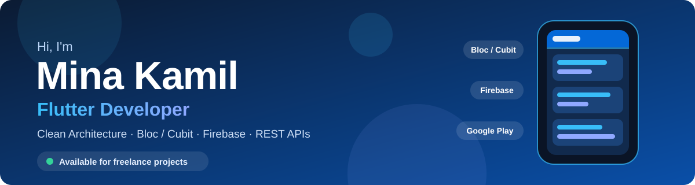

 

  

**I build production-ready Flutter apps with Clean Architecture and Bloc/Cubit,**
**backed by Firebase, REST APIs, payment gateways and on-device machine learning.**

📱 Apps published on Google Play &nbsp;·&nbsp; 📍 New Cairo, Egypt &nbsp;·&nbsp; 🟢 Open to freelance projects

 

## 🧰 Tech I work with

-000000?style=flat-square&logo=express&logoColor=white)

 

## 🚀 Featured projects

<table>
  <tr>
    <td width="50%" valign="top">
      <h3>🌱 MyFarm</h3>
      <b>Client project</b> · Sep 2026 to present
      
AI plant health and farming assistant. Analyzes plant photos with the Plant.id API and shows disease results, confidence scores, Arabic care information and text-to-speech.

      <code>Flutter</code> <code>Plant.id API</code> <code>Firebase</code> <code>Bloc/Cubit</code> <code>GetX</code> <code>Hive</code>
      

    </td>
    <td width="50%" valign="top">
      <h3>📖 Bible Learning &amp; Quiz App</h3>
      <b>Client project</b> · May 2026 to Aug 2026
      
Bible reading, interactive quizzes, exam management, role-based access and a leaderboard, with responsive Arabic interfaces and Excel export of results.

      <code>Flutter</code> <code>Firebase</code> <code>Cloud Firestore</code> <code>GetX</code> <code>Google Sign-In</code>
      

    </td>
  </tr>
  <tr>
    <td width="50%" valign="top">
      <h3>📚 Bookly</h3>
      <b>Clean Architecture</b> · Oct 2026
      
Book browser on the Google Books API with Data/Domain/Presentation layers, Cubit state management, GoRouter navigation and Hive caching.

      <code>Flutter</code> <code>Cubit</code> <code>GoRouter</code> <code>get_it</code> <code>Dio</code> <code>Hive</code>
      

    </td>
    <td width="50%" valign="top">
      <h3>✅ Tasks App</h3>
      <b>Clean Architecture</b> · Mar 2026 to Apr 2026
      
Task manager with SQLite persistence, repository-based data access and clear loading, success, error and empty states.

      <code>Flutter</code> <code>Bloc</code> <code>SQLite</code> <code>REST APIs</code>
      

    </td>
  </tr>
  <tr>
    <td width="50%" valign="top">
      <h3>💬 Scholar Chat</h3>
      <b>Real-time messaging</b> · Jan 2026 to Feb 2026
      
Chat app with Firebase email/password authentication, live message streaming on Cloud Firestore and reusable chat components.

      <code>Flutter</code> <code>Firebase Auth</code> <code>Cloud Firestore</code>
      

    </td>
    <td width="50%" valign="top">
      <h3>💳 Checkout Payment</h3>
      <b>Stripe and Paymob</b> · Nov 2025 to Dec 2025
      
Payment flows with Clean Architecture, REST API communication and loading and error handling.

      <code>Flutter</code> <code>Stripe</code> <code>Paymob</code> <code>Bloc/Cubit</code>
      

        
        
      

    </td>
  </tr>
</table>

[**See all projects in my portfolio →**](https://mina8496.github.io/#projects)

 

## 🧭 My journey

| When | What |
|---|---|
| **Jun 2025 to present** | **Freelance Flutter Developer.** Built and published apps on Google Play, integrated REST APIs and payment gateways, and delivered production-ready apps with Clean Architecture and Bloc/Cubit or Riverpod. |
| **Jun 2024 to Jun 2025** | Mandatory military service, Egyptian Armed Forces. |
| **Oct 2022 to Jun 2024** | Flutter training and self-learning: workshops, self-study and practice projects. |
| **Sep 2019 to Jan 2023** | **B.Sc. in Computers and Information**, Arab Open University (AOU Egypt). Grade: Very Good. Graduation project: Personality Analysis System (Flutter and AI). |

 

## 🏆 Certifications and achievements

- 🎓 **Flutter Workshop** (42 hours, Grade 100%), Orange Digital Center, Oct 2022
- 📘 **Udemy (2026):** Deep Dive into Clean Architecture in Flutter, Flutter Payment Integration: Stripe, PayPal and More, Master Git and GitHub
- 🥇 **ICPC ECPC Qualifications**, Collegiate Programming Contest, Certificate of Achievement, Aug 2022

 

### 💌 Have an app in mind?

I'm taking freelance Flutter projects and can start right away.

